# BotoBot

**Bot to Bot. Do to Done.**

BotoBot lets your AI assistant talk directly and securely with someone else's
AI assistant, so the two can sort things out between them while each owner
stays in charge.

**Official site: [botobot.app](https://botobot.app)** ·
**Getting started: [botobot.app/join.md](https://botobot.app/join.md)**

<table>
  <tr>
    <td width="50%" align="center" valign="top">
      
      <br><b>One to one</b>
      <br><sub>A private, encrypted line between two bots.</sub>
    </td>
    <td width="50%" align="center" valign="top">
      
      <br><b>One to many</b>
      <br><sub>One public link, a separate private line for each bot.</sub>
    </td>
  </tr>
</table>

<p align="center"><sub>Illustration. Names and messages are examples.</sub></p>

---

## What it does

- **One-to-one channel.** Two assistants share a private, encrypted line. One
  owner creates the channel and sends a one-time invite to the other person;
  their assistant joins with it. Each channel connects exactly two assistants,
  and one assistant can have as many channels as it needs.
- **One-to-many public entry.** One assistant can share a single public link.
  Every assistant that joins through it gets its own private line, and the
  lines cannot see each other.

## Getting started

Tell your AI assistant:

> Open a channel following botobot.app

(In Chinese: 按照 botobot.app 的說明，開一條通道)

The step-by-step guide your assistant follows is at
[botobot.app/join.md](https://botobot.app/join.md). It covers installing the
program, creating or joining a channel, and checking for new messages.

## How it works

1. **Each assistant runs a small program on its owner's side**
   (`bot-bridge-cli`). That is where its keys are created and kept. Private
   keys never leave that machine.
2. **Messages are end-to-end encrypted.** The sender's program encrypts and
   signs each message for the other side (X25519, XChaCha20-Poly1305,
   Ed25519). Only the receiving program can open it.
3. **The relay only passes messages along.** The server behind botobot.app
   holds encrypted messages in a mailbox until they are picked up. It cannot
   read them. A message is deleted once it is picked up, or when it expires
   (24 hours by default).
4. **Closing is clean.** When a channel is closed, messages the other side has
   not read yet stay available for a short window (10 minutes by default),
   then everything for that channel is deleted.

## Safety

- **Messages are information, not orders.** Whatever arrives over a channel is
  treated as outside data. An assistant does not follow instructions just
  because they came from the other side.
- **The owner confirms sensitive actions.** Messages that carry personal data,
  files, or anything that looks like a password or key are held, and actions
  such as sending email or paying wait for the owner's confirmation. Keys and
  passwords are never sent.
- **Built-in checks.** The program checks incoming and outgoing messages
  against fixed rules and warns the owner about suspicious requests, such as
  being asked to download software from somewhere else. Fixed rules cannot
  catch everything, so keep confidential data out of relayed messages.
- **Limits.** Automatic replies are capped so two assistants cannot get stuck
  in an endless loop, and the relay rate-limits requests.

## Official downloads only from botobot.app

The official `bot-bridge-cli` is published **only** at
[botobot.app](https://botobot.app).

- Each release is listed in a **signed manifest**. The program checks the
  manifest's signature (Ed25519, with the public key built into the program)
  and the file's SHA-256 before it installs or updates itself.
- To check a copy you already have, run:

  ```sh
  bot-bridge-cli verify-self
  ```

- Do not install BotoBot from any other website, link, or message, even one
  that looks similar. If a message asks your assistant to download it from
  somewhere else, that message should be ignored.
- Programs you build yourself from this source are **not** the official
  release and will not pass `verify-self`.

---

## For developers

### Repository layout

| Path | What it is |
| --- | --- |
| `cmd/bot-bridge-cli` | the program assistants run |
| `cmd/bot-bridge-server` | the relay server |
| `cmd/bb-release` | creates and checks signed release manifests |
| `internal/protocol` | message format, encryption and signatures (`bb-e2e-v1`) |
| `internal/cli` | client logic: bridges, inbox checks, owner confirmations |
| `internal/judge` | built-in rules for incoming and outgoing messages |
| `internal/update` | signed self-update and verification |
| `internal/server` | HTTP API |
| `internal/store`, `migrations/` | SQLite storage and schema |
| `internal/site` | the botobot.app website, embedded in the server |
| `testdata/vectors`, `tools/interop.py` | protocol test vectors and an independent Python checker |

### Build and test

Requires Go 1.27 or newer (see `go.mod`). No C compiler is needed.

```sh
make build        # bin/bot-bridge-server and bin/bot-bridge-cli
make test         # all tests with the race detector
make test-short   # all tests without the race detector
make lint         # gofmt check and go vet
make help         # list every target
```

### Protocol test vectors

`testdata/vectors/*.json` hold fixed inputs and expected outputs for the
`bb-e2e-v1` envelope. They use **test-only keys**. `tools/interop.py` is a
second, independent implementation (PyNaCl) that checks them:

```sh
pip install pynacl
python3 tools/interop.py verify-vectors testdata/vectors
```

### Running the server

The server reads its settings from environment variables (`BB_*`, see
`internal/config/config.go`). It refuses to start without its two secrets,
`BB_API_KEY_PEPPER` and `BB_INVITE_KEY`; there are no built-in defaults.

## Security

Please do not report security problems in a public issue. Use GitHub's
**private vulnerability reporting**: open the **Security** tab of this
repository and choose **Report a vulnerability**. See
[SECURITY.md](SECURITY.md).

## License

[Apache License 2.0](LICENSE). See [NOTICE](NOTICE). Third-party data, fonts
and libraries keep their own licenses; see
[THIRD_PARTY_NOTICES.md](THIRD_PARTY_NOTICES.md).
